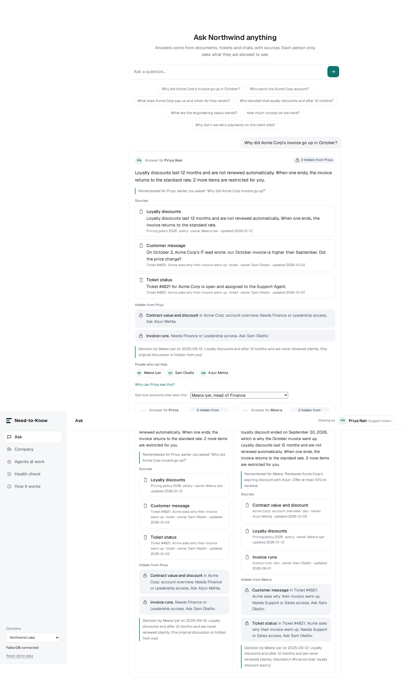
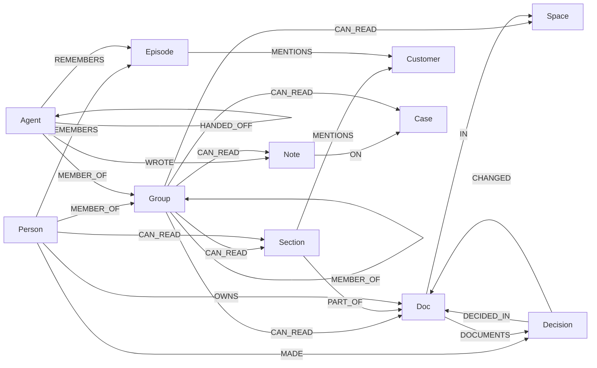
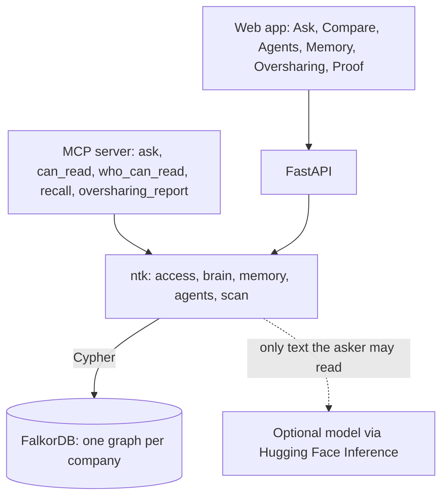

# Need-to-Know

**A company brain that knows who is allowed to know what.** Built on [FalkorDB](https://falkordb.com) for Graph Hacks 2026.

Ask it anything about the company. It answers with sources, but only from what *you* are allowed
to read. Everything else comes back as a redaction bar that says what is missing and who could
grant it. Every person and every AI agent has its own private memory, and when one agent hands
work to another, anything the receiver may not see stays behind.

- **Live demo:** _Hugging Face Space link_
- **Video (3 min):** _YouTube link_
- **Tracks:** Company Brain (primary) · Agent Memory and Coordination · Agents That Act on Connected Data



---

## The problem

Companies want an AI assistant that knows everything. Their biggest fear is that it shows the
wrong person the wrong thing: salaries, contracts, board plans. Access is granted through layers of
groups inside groups that nobody remembers, so nobody can say for sure who can see what. A
document chatbot answers from whatever it finds. That is a leak waiting to happen.

## What Need-to-Know does

| | |
|---|---|
| **Answers with clearance** | Same question, different people, different answers. Facts are cited with their source and owner. Withheld facts become redaction bars that name the groups that could grant them and the person to ask. |
| **Shows why** | For every fact, the exact chain of group memberships that grants it: *Meera Iyer → Leadership → Contract value*. |
| **Private memory per person and per agent** | Memories hang off their owner in the graph. Every memory query starts at the asker's own node, so there is no path to anyone else's. |
| **Agents that share a case safely** | A Support Agent and a Finance Agent work one customer case. The Finance Agent writes a Finance-only note. When the case comes back, that note is redacted for the Support Agent, so the customer reply cannot contain the contract value. A person approves the reply. |
| **Finds oversharing and fixes it safely** | It walks the access graph backwards from every sensitive document, compares who *should* read it with who *can*, and finds the grant that causes the gap. It tests the fix on a `GRAPH.COPY` fork of the company, and applies it only after a person approves. The change is recorded as a decision. |
| **Keeps up with change** | People who moved teams but kept their old access are flagged with the documents they can still open. |

The demo company, Northwind Labs, has 211 people, 3 AI agents and 19 groups nested up to 4 deep.
It has three planted problems for the scan to find:

* The **salary sheet** can be opened by **211 people** instead of 3, through a forgotten "Drive migration 2023 (temporary)" group. That includes 12 external contractors and even the AI agents.
* The **Q3 board deck** reaches **34 people** instead of 5, through a project group that contains the contractors.
* **Ravi Kumar** moved from Finance to Engineering two months ago and can still read every contract value.

All data is synthetic, generated by a seeded script ([`ntk/seed.py`](ntk/seed.py)).

## Why the graph has to do the work

"Can this person read this sentence?" means following person → team → group → group inside a
group → space → document → section. That chain *is* a graph traversal, and it runs on every
question, every agent step and every scan.

| Capability | How FalkorDB does it |
|---|---|
| Resolve a person's or agent's access through nested groups | One variable-length traversal: `(p)-[:MEMBER_OF*0..8]->(g)-[:CAN_READ]->(t)` |
| Explain an answer | Shortest membership path to the grant, with who granted it, when and why |
| Find candidate passages | FalkorDB full-text index on `Section(text, label)` |
| Who can open a document | Reverse traversal from the document to every person |
| Find the grant that causes oversharing | Per-grant reach, compared with the intended audience |
| Test a fix without risk | `GRAPH.COPY` the company, change the fork, re-measure, delete the fork |
| Separate companies | One graph per tenant in one FalkorDB instance (`northwind`, `bluefin`) |
| Private memory, shared case state, handoffs | `REMEMBERS`, `ON`, `HANDED_OFF` edges; reads start from the requester |

Every query is listed with its purpose in **[QUERIES.md](QUERIES.md)**.

## Proof: switch the graph off and see what breaks

54 people and agents × 8 questions, checking every passage the search returned. Each one is
compared with ground truth computed **independently in plain Python** from the company data
(`seed.expected_readable_sections`).

| Access check | Leaks | Wrong denials | Helpfulness |
|---|---|---|---|
| **Graph traversal (Need-to-Know)** | **0** | **0** | **100%** |
| Flat list: direct groups only, as a simple ACL would do | 0 | 521 | 37.5% |
| Off: a plain document chatbot | 840 | 0 | 100% |

* FalkorDB's traversal agrees with the Python ground truth on **100% of 6,634** (principal, passage) pairs.
* A full access check takes **~0.3 to 0.4 ms** (median). That is about **3,500 checks per second** across 8 threads and about **5,000 concurrent memory writes per second**.
* Reproduce with `python -m ntk.eval`. CI runs it on every push ([`ci.yml`](.github/workflows/ci.yml)), together with 13 tests and screenshots of every screen.

## Graph data model



* `Person`, `Agent` and `Group` all carry the `Principal` label, so one traversal handles all three.
* `CAN_READ` edges carry `granted_by`, `granted_at` and `reason`, which is what makes "why can I see this?" and the oversharing report answerable.
* A `Section` inherits its document's access unless it is `restricted`; a restricted section needs its own grant.
* Indexes: range indexes on `id` for every label, and a full-text index on `Section(text, label)`.

## Architecture



The optional language model only ever receives text the asker is already allowed to read, so it
can phrase an answer but cannot leak or decide access. Without a token, every answer is produced
deterministically.

## Run it

**One container (FalkorDB and the app together; this is what the Hugging Face Space runs):**

```bash
docker build -t need-to-know .
docker run -p 7860:7860 need-to-know
# open http://localhost:7860
```

**For development, with FalkorDB in Docker:**

```bash
docker run -d -p 6379:6379 falkordb/falkordb:latest
pip install -r requirements-dev.txt
python -m ntk.seed                     # load the two companies
uvicorn ntk.api:app --reload           # http://localhost:8000
pytest -q                              # 13 tests against the real database
python -m ntk.eval                     # the benchmark above
```

**Optional:** `HF_TOKEN=hf_...` lets a model phrase answers (`HF_MODEL` to choose one).
`FALKORDB_HOST`, `FALKORDB_PORT`, `FALKORDB_USERNAME` and `FALKORDB_PASSWORD` point at any FalkorDB, including FalkorDB Cloud.

**MCP:** `pip install -r requirements-mcp.txt && python mcp_server.py` exposes the brain to Claude Code, Cursor or any MCP client.

## A 3-minute tour

1. **Ask** as Priya, a support intern: *"Why did Acme Corp's invoice go up in October?"* She gets the pricing policy and a redaction bar for the contract value.
2. **Same question, two people:** Priya next to Meera, Head of Finance. Meera sees *₹38,00,000 a year, 18% discount ended Sept 30*. Priya does not.
3. Switch **Access check: Off**. The red LEAK badges are what a plain document chatbot would show.
4. **Agents & handoffs:** run the case, then run it again with access checks off. Watch the contract value appear in the customer reply, and the approval being refused.
5. **Private memory:** try to read Meera's memories as Priya. The count is 0, and the page shows the query that proves why.
6. **Oversharing:** scan, test the salary-sheet fix on a fork (211 → 3 readers, everyone who should keep access keeps it), approve it, and see the decision recorded.
7. **Proof:** the benchmark table, live.

## Tracks

* **Company Brain (primary).** Documents, tickets, chats and decisions in one graph. Who owns what, and who can see what. Decisions traced to their source. Kept current as people change teams. Every answer cites its sources.
* **Agent Memory and Coordination.** Separate, persistent memory per person and per agent, plus one graph per company. Shared case state and handoffs between agents that respect each agent's clearance. Concurrent reads and writes are benchmarked.
* **Agents That Act on Connected Data.** Graph algorithms as tools (traversal, reverse reach, fork-and-test). The agent acts on what the graph shows: redacting, routing a case, proposing and applying access fixes after approval. Tools are exposed over MCP.

## Safety

* Access is decided by graph traversal, never by the model.
* The model never sees restricted text.
* Redaction bars reveal that something exists and who could grant it. Hiding it entirely is a one-line policy change.
* Fixes are tested on a copy and applied only after a person approves, with a decision record.
* All data is synthetic.

## Limitations

* Retrieval is keyword and full-text search, not embeddings. That is enough for the demo corpus; vector search would slot in front of the same access check.
* The MCP server takes the acting principal as a parameter for demo purposes. In production it would come from the authenticated session.

## AI assistance

An AI coding assistant helped write parts of the code and documentation for this project. The
design, the data model, the tests and the results in this README were reviewed and verified by
the author.

## License

MIT
